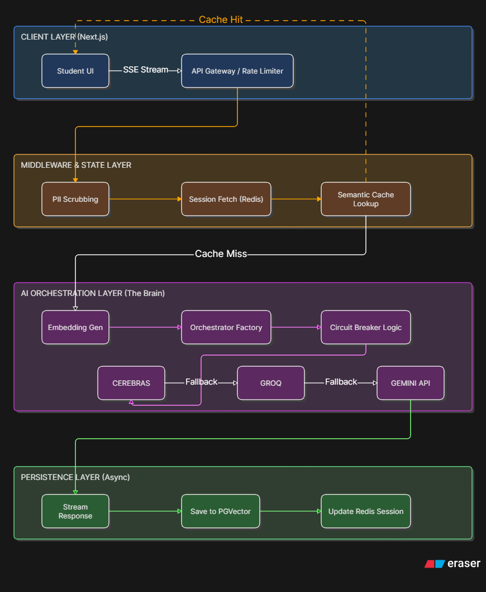

# 🚀 ExamPrep AI Engine

ExamPrep AI is a high-performance, fault-tolerant academic intelligence engine designed to generate dynamic study notes and mock papers for large-scale university syllabi (e.g., AKTU). 

The system leverages a multi-LLM orchestration strategy (**Cerebras, Groq, Gemini**) combined with an advanced semantic caching layer to deliver sub-second responses.

---

## 📐 System Architecture



---

## 🛠️ Tech Stack

* **Runtime:** Node.js, TypeScript
* **Orchestration:** Custom LLM Factory (Multi-provider Fallback)
* **Database:** PostgreSQL (via Prisma ORM)
* **Vector Search:** `pgvector` (HNSW indexing for $O(\log N)$ latency)
* **Streaming:** Server-Sent Events (SSE) for low-latency UI updates

---

## ⚡ Key Architectural Features

* **Semantic Caching:** Utilizes PostgreSQL (`pgvector`) to perform sub-millisecond nearest-neighbor searches, bypassing expensive LLM calls for frequently queried academic topics.
* **Resilient Circuit Breaker:** An automated fallback mechanism that detects provider downtime (e.g., Groq/Cerebras) and immediately reroutes requests to an alternative model to ensure **99.9% uptime**.
* **Dynamic Academic Routing:** Intelligent intent classification that switches between *Note Generation* and *Dynamic Mock Exam Generation* based on the incoming request type.
* **Production-Ready Security:** Implements rigorous rate-limiting, PII (Personally Identifiable Information) scrubbing, and context-window protection to maintain system integrity.

---

## 🏗️ Core Pipeline

> **How a request flows through the engine:**
> 1. **Scrubbing:** Middleware layer sanitizes the incoming prompt by redacting PII (Email/Phone).
> 2. **Vector Lookup:** The system queries the `SemanticCache` using HNSW indexing to identify existing answers.
> 3. **Orchestration:** If no cache match is found, the LLM Factory triggers a stream from the most stable available provider.
> 4. **Async Persistence:** Post-generation, the response is asynchronously stored in the vector database to optimize future response times.

---

## 📊 Monitoring & Analytics

The system integrates a dedicated `ProviderLog` table to monitor the live performance, latency, and reliability of third-party models. This allows for data-driven analysis to prioritize stable providers and optimize operational API costs.

---

## 🚀 Getting Started

### Prerequisites
* Node.js (v18+)
* PostgreSQL with `pgvector` extension enabled
* API Keys for **Groq**, **Cerebras**, and **Google Gemini**

### Installation

1. **Clone the repository:**
   ```bash
   git clone [https://github.com/your-username/exam-prep-ai.git](https://github.com/your-username/exam-prep-ai.git)
   cd exam-prep-ai

 Install dependencies:
     npm install

 Setup environment variables:
    cp .env.example .env
    Open the .env file and input your specific API keys and Database URL.

 Run database migrations:
     npx prisma migrate dev

 Start the development server:
   npm run dev
